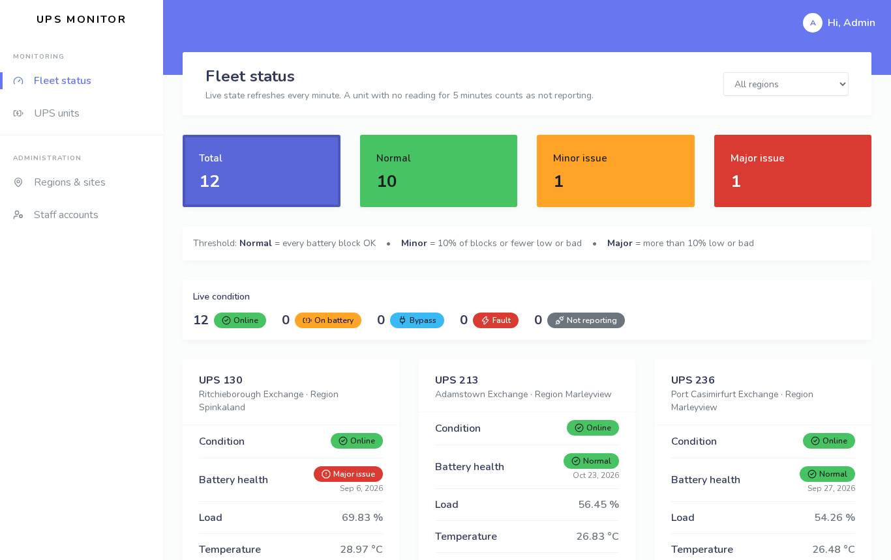
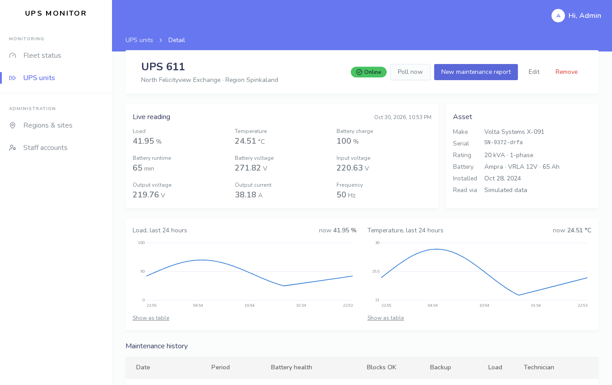
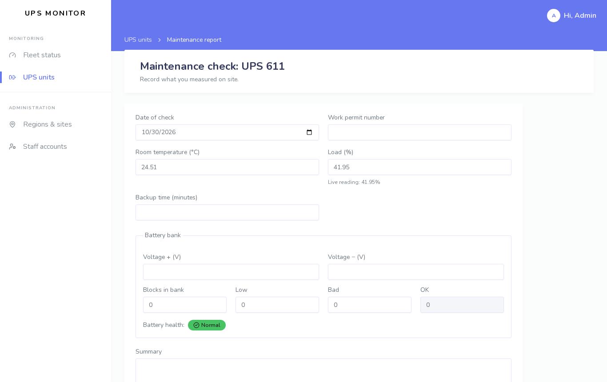
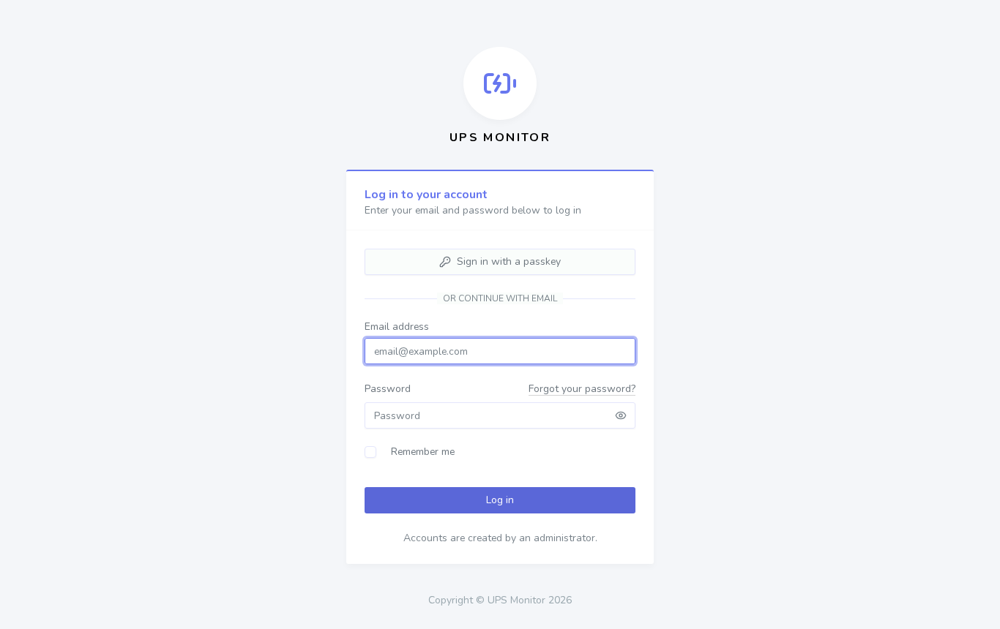

# UPS Monitor

Live monitoring and maintenance records for a fleet of UPS units spread across regional sites. Each UPS is polled every minute through the web status page on its network management card, and every reading is stored as history. Technicians record quarterly maintenance checks against the same units.

A from-scratch rewrite of a 2021 Laravel 6 maintenance-reporting app. No client code, names, network addresses or data are included. The demo fleet uses a simulated driver.

## Screenshots

**Fleet status: battery-health tiles filter the unit cards**



**Unit detail with 24-hour charts and maintenance history**



**Maintenance report form**



**Sign-in**



## Features

- **Fleet status**
    - **Live condition** of every unit (online, on battery, bypass, fault), refreshed every minute. A unit with no reading for `UPS_STALE_AFTER_MINUTES` shows as **not reporting**, whatever its last status said.
    - **Battery health from the last maintenance check:** normal when every block is OK, minor while at most 10% of blocks are low or bad, major beyond that.
- **Unit detail**
    - The live reading (load, temperature, battery, voltages, frequency) and the asset record.
    - 24-hour charts of load and temperature, with a crosshair tooltip, arrow-key reading and a table view.
    - The maintenance history, and a **Poll now** button for an immediate reading.
- **Maintenance reports:** date, work permit number, room temperature, backup time, load, battery voltages and block counts, a summary and an attached signed report. The form rejects counts where OK, low and bad blocks do not add up to the bank size. Technicians edit their own reports; admins edit any.
- **Polling**
    - `ups:poll` queues one job per active unit, so an unreachable card only delays its own reading.
    - The `html` driver parses the card's label/value status table with PHP 8.4's `Dom\HTMLDocument`. It handles per-phase values and pages served with an error status. When the card shows no load figure, load is derived from output power against the rated capacity.
    - A failed poll is recorded without touching the last good reading.
- **Retention:** readings older than `UPS_RETENTION_DAYS` are pruned daily.
- **Roles:** admins manage units, regions and sites, and accounts. Technicians monitor units and file reports.

## Design

The interface follows the original's Stisla admin template, rebuilt in Tailwind: a white left sidebar, a coloured band behind the top bar, white section headers and cards, and Nunito type. The fleet page keeps the original's layout: four battery-health tiles that filter the units, the threshold note, then one card per unit. Tile and badge colours are Stisla's, with shades or text colour adjusted where contrast fell short. Light theme only, as the original was.

## Stack

Laravel 13 · PHP 8.4 · Inertia 3 + Vue 3 + TypeScript · Tailwind 4 · Fortify (passkeys, 2FA) · queued jobs and scheduler · PHPUnit · Larastan level 7

## Development

```bash
composer run setup
php artisan migrate:fresh --seed   # 12 simulated units, 24 hours of readings, one unit not reporting
composer run dev                   # also run: php artisan schedule:work
```

Demo sign-ins (password `password`):

| Email                    | Role       |
| ------------------------ | ---------- |
| `admin@example.com`      | Admin      |
| `technician@example.com` | Technician |

```bash
php artisan test
composer run types:check   # Larastan
npm run check && npm run types:check
```
